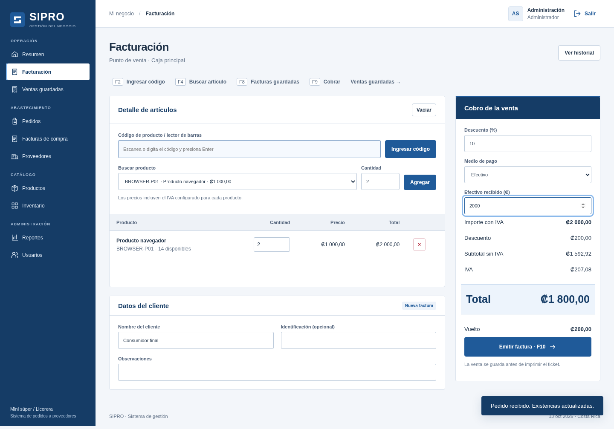
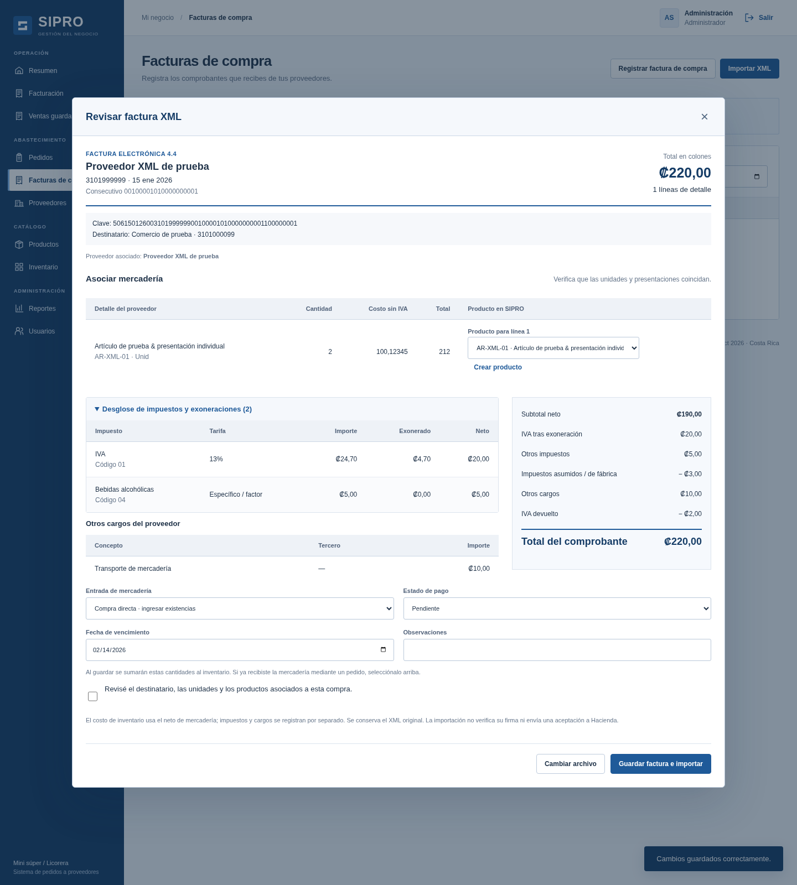

# SIPRO — Sistema de Gestión de Pedidos a Proveedores

Demostración funcional para un Mini Súper / Licorera, basada en **Proyecto de Sistemas.pdf** y en las pantallas del ZIP original. Incluye siete módulos conectados, datos persistentes y dos roles. Conserva el nombre, los productos iniciales y el cálculo de precios con IVA incluido de la propuesta de facturación original, con una interfaz de operaciones en azul y blanco para el trabajo diario.

## Ejecutar

Requisito: **Node.js 24 LTS o superior**, disponible en [nodejs.org](https://nodejs.org/). No se necesita instalar un servidor de base de datos ni configurar claves.

Desde la carpeta que contiene `package.json`:

```sh
npm ci
npm start
```

Abre en tu navegador la dirección local del puerto **3000** (`127.0.0.1:3000`). Mantén la terminal abierta mientras utilizas el sistema. Detén el servidor con `Ctrl+C`.

La instalación inicial necesita Internet: `npm ci` instala el lector XML y las herramientas de prueba. Después, la aplicación funciona localmente sin Internet. No consulta ni envía documentos a Hacienda. No abras el HTML con doble clic o Live Server: los formularios necesitan el servidor de SIPRO.

| Rol           | Usuario de demostración | Contraseña de demostración |
| ------------- | ----------------------- | -------------------------- |
| Administrador | `admin`                 | `Admin123!`                |
| Dependiente   | `dependiente`           | `Caja123!`                 |

Estas cuentas contienen datos ficticios para la presentación. En **Usuarios** puedes crear cuentas y modificar contraseñas. El formulario de inicio acepta el nombre de usuario.

## Funcionalidades

- **Seguridad:** inicio y cierre de sesión, usuarios, edición de credenciales, estado y roles. Los permisos se verifican en el servidor, las contraseñas se guardan con scrypt y las sesiones usan cookies HttpOnly. Cerrar sesión, cambiar la contraseña o desactivar al usuario invalida el acceso correspondiente.
- **Proveedores:** alta, edición, activación/desactivación, identificación única, contacto, catálogo y condiciones comerciales.
- **Productos:** catálogo, búsqueda por nombre/código, filtros de categoría/estado, IVA configurable, precio, presentación y asociación con varios proveedores y sus precios de compra.
- **Inventario:** existencias iniciales, ajustes con motivo, mínimos y alertas, registro de entradas/salidas y consulta de proveedores asociados.
- **Pedidos:** selección de proveedor/productos, cantidades, revisión antes de guardar, modificación de pedidos pendientes, búsqueda y recepción completa. Recibir un pedido suma sus existencias una sola vez.
- **Facturación:** cliente, productos, descuento porcentual, IVA por producto, efectivo/tarjeta/SINPE, vuelto, consecutivo, historial y filtros. Anular requiere administrador y motivo; restaura las existencias una sola vez. Las facturas conservan los precios originales.
- **Reportes:** pedidos, compras recibidas, productos solicitados, ventas, inventario actual y utilidad bruta estimada. Consulta por fechas, proveedor y estado cuando aplica; impresión/PDF y exportación a Excel para administradores.

**PDF:** las ventas se imprimen como ticket de 80/58 mm; los reportes se imprimen en A4. El botón abre el diálogo del navegador; selecciona **Guardar como PDF**. Permite reimprimir comprobantes históricos. **Excel:** se descarga un archivo `.xls` con contenido SpreadsheetML (XML de Excel); no es un CSV renombrado. Excel puede mostrar un aviso de compatibilidad por ser un formato XML antiguo; también se puede abrir en LibreOffice Calc.

## Caja, ventas guardadas y tickets

La interfaz recupera el **azul de la primera versión** (#1f5a99 y #153c66), con una distribución nueva: barra lateral agrupada, plegable en móvil, resumen en una franja de indicadores, buscadores integrados con sus tablas y formularios de superficies planas. La caja prioriza la entrada de artículos y coloca el cliente debajo; el panel de cobro permanece a la derecha en escritorio. Acceso, catálogo, compras, reportes y diálogos comparten el nuevo sistema visual. Las [decisiones y fuentes](docs/DISENO-IMPORTACION-XML.md) explican los cambios. Conserva la identidad de SIPRO; no es una integración ni una reproducción oficial de Qupos.



[Ver pantalla de acceso](docs/capturas/acceso.png) · [Ver resumen del negocio](docs/capturas/resumen.png) · [Ver ejemplo de ticket de 80 mm](docs/capturas/ticket-80.png)

- **Facturación:** ingresa productos por código o lector de barras que funcione como teclado y finalice con Enter. También puedes seleccionarlos del catálogo. Indica cantidades, descuento y forma de pago; pulsa **Emitir factura** para guardar la venta.
- **Ventas guardadas:** consulta facturas por número, cliente, fechas y estado. Abre **Ver / reimprimir ticket** para imprimir comprobantes anteriores. Reimprimir no crea otra venta ni vuelve a descontar inventario.
- Atajos de caja: **F2** código, **F4** catálogo, **F8** historial, **F9** cobro y **F10** emitir factura (valida los campos antes de guardar). Los atajos se desactivan mientras hay un diálogo abierto.

### Imprimir un ticket

1. Emite una factura o abre una venta guardada.
2. Selecciona **80 mm** o **58 mm** en **Ancho del ticket**. La preferencia queda en ese navegador; el valor inicial es 80 mm.
3. Pulsa **Imprimir ticket** y elige tu impresora térmica instalada en Windows, macOS o Linux. También puedes seleccionar **Guardar como PDF**.
4. Usa el ancho de rollo correspondiente, escala **100%**, sin encabezados ni pies de página del navegador. Si el controlador impone otro tamaño, selecciona el mismo ancho en sus preferencias.

El ticket incluye número, fecha/hora (para ventas nuevas), cajero, cliente, productos, cantidades, precios, descuento, IVA, total, pago y vuelto. El largo del PDF se adapta al contenido. Las facturas anuladas se imprimen identificadas como **FACTURA ANULADA**. Los reportes y registros de facturas de proveedores mantienen su formato A4.

La impresión utiliza el diálogo del navegador: no incluye impresión silenciosa, apertura de gaveta ni comandos de corte ESC/POS. Se verificó el contenido y tamaño de los PDF de 80/58 mm; la impresión física debe probarse con el modelo y controlador disponibles en tu PC.

## Facturas de compra de proveedores

En **Facturas de compra → Registrar factura de compra**, el administrador ingresa el número original de la factura, proveedor, fecha, productos, cantidades, costo unitario **sin IVA**, impuesto y descuento por línea. El sistema calcula el subtotal, IVA y total; comprueba que no se repita el mismo número para el mismo proveedor.

Elige el origen correcto:

- **Compra directa:** mercadería que ya recibiste sin un pedido registrado. Guardar la factura suma las cantidades al inventario y actualiza el costo promedio sin IVA, incluyendo el descuento. No uses esta opción si esa mercadería ya se ingresó al inventario.
- **Pedido recibido:** selecciona el pedido previamente recibido del proveedor. Se cargan sus productos y cantidades; puedes ingresar los costos e impuestos del comprobante. Guardar la factura **no vuelve a sumar existencias ni modifica el costo promedio que dejó la recepción**. Cada pedido completo admite una factura; no se incluyen facturas parciales ni agrupación de varios pedidos.

Las compras directas nuevas guardan una confirmación de inventario con **cantidad anterior, unidades ingresadas y cantidad posterior por producto**. La encontrarás al abrir el detalle de la factura; refleja el momento del registro. Las facturas vinculadas a pedidos recibidos indican que sus existencias ya se ingresaron, para evitar duplicarlas. Las facturas antiguas conservan sus movimientos originales.

Puedes indicar **Pagada** o **Pendiente**, con fecha de vencimiento para compras a crédito. El detalle permite registrar el pago completo e imprimir/guardar el registro como PDF. El pago es un registro interno: no realiza una transferencia bancaria. El dependiente puede consultar las facturas, pero solo el administrador puede registrarlas o marcarlas como pagadas.

En **Reportes**, selecciona **Facturas de compra** para consultar y exportar por fechas, proveedor y estado de pago. El reporte anterior **Compras recibidas** sigue mostrando exclusivamente recepciones de pedidos; no sumes ambos reportes como si fueran operaciones diferentes.

### Importar el XML del proveedor

1. Como administrador, abre **Facturas de compra → Importar XML** y selecciona el archivo original del proveedor.
2. Pulsa **Revisar XML**. Comprueba el emisor, destinatario, fecha, consecutivo, detalle e importes.
3. El proveedor se identifica por su cédula. Si falta, **Registrar proveedor del XML** permite completar sus datos y volver a la revisión. Los productos se sugieren por código comercial; el código CABYS no se usa como código interno. Selecciona los productos correspondientes o usa **Crear producto** para completar el catálogo. El alta comienza con existencias en cero.
4. Revisa que la **unidad y presentación** del proveedor equivalgan a las de tu catálogo. Elige compra directa o un pedido recibido y especifica el estado de pago. Por defecto queda pendiente: el XML no demuestra que hayas pagado.
5. Marca la confirmación y pulsa **Guardar factura e importar**. La factura, su XML y los movimientos se conservan juntos en SQLite. El detalle permite **Descargar XML original**.

Se admiten documentos `FacturaElectronica` de Costa Rica **4.3 y 4.4**, en **CRC**, UTF-8, de hasta **1 MB y 100 líneas**, con cantidades enteras. Ahora incluye **IVA, impuestos específicos, varios impuestos por línea, exoneraciones, impuestos asumidos/de fábrica, otros cargos e IVA devuelto**. Se conservan los importes de origen hasta cinco decimales; los totales contables y la pantalla resumen muestran colones a dos decimales. Se comprueban las sumas y se rechazan claves/consecutivos duplicados. Se aceptan fechas anteriores al inicio de SIPRO, pero no futuras; el movimiento de inventario corresponde al día del registro.

El detalle y la revisión muestran impuestos por código/tarifa, importes exonerados, cargos y ajustes separados; los reportes y Excel conservan el mismo desglose. El total sigue la fórmula: **neto + impuestos netos + cargos − IVA devuelto**. Se importan los impuestos declarados sin convertirlos todos a un porcentaje de IVA. El costo promedio de inventario usa el neto de mercadería; no distribuye impuestos ni cargos entre productos.

No se admiten mediante XML otras monedas, cantidades fraccionarias ni surtidos de productos. El sistema explica el motivo sin guardar una compra parcial. No verifica firmas ni realiza aceptación fiscal ante Hacienda; es una importación administrativa, no una validación tributaria completa del XML.



Las facturas manuales no tienen un adjunto XML. Conserva sus documentos por separado. No se editan/anulan compras registradas ni se gestionan pagos parciales. Revisa los datos antes de guardar.

## Actualizar en tu PC conservando tus datos

1. Detén SIPRO con `Ctrl+C` en la terminal.
2. Haz una copia de seguridad de la carpeta **`data`** completa.
3. Descarga el ZIP actualizado de GitHub y descomprímelo. Copia el contenido de `Web-main` sobre la carpeta anterior del proyecto, reemplazando los archivos de código. **Conserva tu carpeta `data`**: el ZIP no contiene una base de datos que debas sustituir.
4. Ejecuta `npm ci` y después `npm start` desde esa carpeta y vuelve a iniciar sesión. Recarga el navegador para ver el nuevo diseño, **Facturas de compra** y **Ventas guardadas**.

El formato anterior de la base se adapta automáticamente. No necesitas borrar datos, reinstalar Node ni volver a registrar usuarios, ventas o inventario.

## Demostración sugerida

1. Inicia sesión como administrador. El resumen muestra productos con existencia baja.
2. En **Pedidos**, crea uno de **Lácteos y abarrotes Central**, agrega 10 unidades de arroz, revisa y confirma.
3. Abre el pedido y confirma su recepción. En **Inventario**, el arroz pasa de 6 a 16 unidades.
4. En **Facturación**, vende 2 unidades de arroz. Precio total sin descuento: ₡2.700. Introduce ₡3.000 de efectivo: vuelto ₡300. Al emitir, quedan 14 unidades.
5. Guarda o imprime el comprobante. En el historial, anúlalo con la justificación «Devolución de demostración»: quedan nuevamente 16 unidades.
6. En **Reportes**, consulta compras recibidas y exporta a Excel o PDF.
7. Cierra sesión y entra como dependiente: puede vender, preparar pedidos y consultar, pero no administrar usuarios, modificar inventario, recibir pedidos ni anular facturas.
8. Reinicia el servidor: los registros se conservan; será necesario volver a iniciar sesión.

## Datos y configuración

La primera ejecución crea `data/sipro.sqlite` con tres proveedores, seis productos y dos usuarios ficticios. No agrega ventas ni pedidos inventados. Las pruebas usan bases temporales independientes.

- Los datos sobreviven a recargas del navegador y reinicios del servidor. Las sesiones no sobreviven al reinicio.
- SQLite guarda cada operación y sus movimientos en una única transacción. Para mantener sencillo el proyecto académico, se almacena un documento agregado en la tabla `app_state`.
- Para respaldar o transferir los datos, detén el servidor y copia la carpeta `data/` completa.
- Para una nueva demostración vacía de operaciones, detén el servidor y **renombra** `data/` conservándola como respaldo. La siguiente ejecución creará datos iniciales nuevos.
- `PORT`: puerto, por defecto `3000`.
- `HOST`: dirección de escucha, por defecto `127.0.0.1`.
- `SIPRO_DB`: ruta alternativa del archivo SQLite.
- `SIPRO_SECURE_COOKIE=1`: cookies Secure cuando se sirve mediante HTTPS.
- Las fechas del negocio usan `America/Costa_Rica`.

## Verificación

Pruebas de integración, después de ejecutar `npm ci`:

```sh
npm test
```

Prueba completa de navegador (opcional):

```sh
npm ci
npx playwright install chromium
npm run test:browser
```

Si ya tienes Chromium en Linux:

```sh
SIPRO_CHROMIUM=/usr/bin/chromium npm run test:browser
```

Los recorridos de navegador incluyen importación XML, alta de proveedor/producto, descarga del original, persistencia y revisión móvil. Usan registros temporales y generan capturas, un PDF y un Excel en `test-results/`, sin modificar los datos de la aplicación. En Linux, Playwright puede requerir bibliotecas del sistema; consulta su instalación oficial si no están presentes.

## Estructura

```text
public/               HTML, estilos y JavaScript de la interfaz
server.js             Servidor HTTP, API, sesiones y exportación Excel
src/domain.js         Validaciones, permisos y operaciones de negocio
src/store.js          SQLite y datos de demostración
tests/               Pruebas de integración y recorrido en navegador
docs/                 Correspondencia con el PDF y referencia original
data/                 Base local generada (no se incluye en Git)
```

Las rutas originales `/Vistas/Login.html`, `/Vistas/Index.html` y `/Vistas/Facturar.html` siguen funcionando a través del servidor. La versión original de facturación se conserva en `docs/Facturar-original.html` como referencia; no se sirve como parte de la aplicación.

## Alcance académico

Consulta [la correspondencia con los requisitos](docs/REQUISITOS.md) para ver las decisiones y límites. Es una demostración funcional local, no un sistema fiscal ni una aplicación preparada para producción: no envía pedidos a proveedores externos, no valida pagos bancarios, no emite comprobantes electrónicos de Hacienda ni calcula contabilidad completa. La utilidad es una estimación basada en el costo de los productos vendidos. Los datos de demostración y sus contraseñas son públicos.
