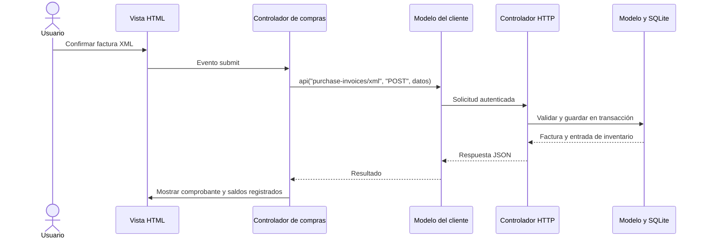

# Arquitectura MVC de SIPRO

La aplicación conserva Node.js, SQLite y JavaScript nativo. La separación MVC está presente tanto en la API como en la interfaz: los modelos manejan datos y reglas, las vistas presentan información y los controladores coordinan las acciones. Los archivos no son simplemente tres copias del antiguo `app.js`.

## Servidor

| Capa | Archivos | Responsabilidad |
| --- | --- | --- |
| Entrada | `server.js` | Puerto, variables de entorno, inicio y cierre. Exporta `createApp` para las pruebas. |
| Controlador | `src/controllers/http-controller.js` | Recibir HTTP, validar sesión/origen, dirigir cada operación al modelo y devolver respuestas. Sirve únicamente archivos del directorio público. |
| Modelo | `src/models/domain.js` | Permisos, validaciones de negocio, pedidos, ventas, compras, inventario y reportes. |
| Modelo | `src/models/store.js` | Persistencia y transacciones SQLite, contraseñas y datos iniciales. |
| Modelo | `src/models/order-recommendations.js` | Calcular faltantes, descontar pendientes, asignar proveedor y comprobar propuestas antes de confirmar. |
| Modelo | `src/models/dashboard.js` | Validar filtros y agregar ventas por calendario, pago, producto y proveedor del catálogo. |
| Modelo | `src/models/purchase-xml.js` | Leer y validar el documento, asociar productos y registrar la compra. |
| Vista | `src/views/spreadsheet.js` | Convertir el resultado del reporte en SpreadsheetML para Excel. |

El modelo no importa controladores ni vistas. Las operaciones que modifican inventario siguen dentro de la transacción de `store.change()`. Una compra directa y sus movimientos se guardan juntos; una factura ligada a un pedido recibido conserva sus existencias. El navegador no decide permisos ni importes fiscales definitivos.

## Navegador

| Capa | Directorio | Responsabilidad |
| --- | --- | --- |
| Modelo | `public/js/models/` | Estado de sesión y borradores, comunicación JSON con la API, preferencias del ticket y totales provisionales. No accede al DOM ni importa vistas. |
| Controlador | `public/js/controllers/` | Leer formularios, atender eventos, llamar al modelo y actualizar la vista. Hay controladores de catálogo, inventario, pedidos, compras, ventas, reportes y usuarios. |
| Vista HTML | `public/views/` | Estructura de las pantallas, formularios, filas, diálogos y comprobantes. |
| Presentación JS | `public/js/views/` | Formato de moneda/fechas, composición de componentes, navegación, diálogo, notificaciones e impresión. |
| Presentación CSS | `public/styles/index.css`, `glass.css`, `dashboard.css` | Distribución e impresión; tema azul global y composición del dashboard aplicados exclusivamente a pantalla. `glass.css` conserva su nombre histórico, pero su contenido actual es el tema azul. |

`public/index.html` contiene el documento inicial, el contenedor de la aplicación, el diálogo y el área de impresión. `public/js/app.js` carga las plantillas y arranca el controlador principal mediante módulos ES. No hay JavaScript ni CSS en línea en las plantillas.

## Plantillas

Cada archivo contiene fragmentos identificados, por ejemplo `login-1` o `purchase-invoices-page-1`. `view(nombre, datos)` sustituye marcadores `{{{nombre}}}` sin ejecutar código. Los marcadores reciben texto escapado por `esc()` o fragmentos HTML creados por otras vistas. No se debe pasar texto libre del usuario directamente a un marcador: usa `esc(valor)` para contenido o atributos. Monedas y fechas pasan por sus formateadores.

El motor no interpreta expresiones JavaScript ni vuelve a procesar marcadores que aparezcan dentro de un valor. Una plantilla o dato requerido ausente produce un error explícito. Las pruebas cargan todas las plantillas reales, incluidas las de una sola línea, y comprueban el escape de datos en campos y tablas. Las tablas se componen con filas y celdas completas.

## Guía para modificar

- **Cambiar estructura o texto de una pantalla:** editar su archivo en `public/views/`.
- **Cambiar colores, superficies, sombras o transiciones:** editar los tokens y componentes de `public/styles/glass.css`. El dashboard usa esos mismos tokens y conserva su distribución en `dashboard.css`. Ambos están limitados a `screen`; no modifican el papel del ticket.
- **Cambiar un evento o el proceso de un formulario:** editar el controlador correspondiente en `public/js/controllers/`.
- **Cambiar las reglas de inventario, impuestos o permisos:** editar el modelo del servidor en `src/models/`. Los cálculos del cliente solo ayudan a presentar el borrador.
- **Añadir una colección de vistas:** incluirla en `loadTemplates()` de `public/js/app.js` y reiniciar el servidor para actualizar el listado de recursos públicos.

La base sigue en `data/sipro.sqlite` y conserva su esquema. Esta reorganización no reinicia registros ni necesita una migración. Las rutas API y la forma de iniciar con `npm start` siguen vigentes.

## Verificación

`npm test` ejecuta pruebas del negocio, XML, persistencia, plantillas y recursos públicos. `npm run test:browser` recorre formularios reales en Chromium, incluyendo compras manuales/XML, inventario, pagos, roles, móvil, Excel y tickets de 80/58 mm. Las pruebas crean bases temporales. Las fuentes y las plantillas se sirven desde el mismo origen y se mantiene la política CSP sin `unsafe-inline` ni `unsafe-eval`.

## Reposición por mínimos

`GET /api/orders/recommendations` devuelve grupos por proveedor y excepciones sin escribir en la base. El cálculo vive en `src/models/order-recommendations.js`; la consulta y el borrador se coordinan desde `public/js/controllers/order-recommendations.js` y `orders.js`, con plantillas de `public/views/orders.html`.

`POST /api/orders/recommendations` recibe el proveedor, las líneas editadas y el token de la propuesta. Recalcula y compara dentro de `store.change()` antes de usar las validaciones normales de `saveOrder()`. El token incluye los datos del grupo y el último pedido de ese proveedor: una segunda confirmación del mismo borrador no crea otra compra, incluso si se sustituyeron los artículos originalmente sugeridos. Un conflicto devuelve 409 y permite recalcular. Los pedidos guardados conservan `origin: "recommended"`, también al editarlos.

No hay migración de esquema ni cambio de formato de los pedidos anteriores. El controlador HTTP exige la misma sesión y protección de origen que para los pedidos manuales. La recomendación no es un permiso para omitir mínimos comerciales, artículos activos ni asociaciones válidas.

## Estadísticas de ventas

`GET /api/dashboard` requiere sesión y permite ambos roles. Parámetros: `period=day|week|month|range`, `date=YYYY-MM-DD`, `days=1,2,3` (lunes=1, domingo=7), `from`, `to` para Rango y `year` para las series mensuales. Los días se aplican al detalle semanal; omitidos incluye todos y vacíos ninguno. La fecha de referencia sigue determinando las tarjetas y la semana contextual; el año de las series puede consultarse independientemente. Los filtros inválidos devuelven 400.

El modelo `src/models/dashboard.js` agrega importes en centavos, incluye IVA y descuentos y excluye facturas anuladas y futuras. Devuelve tarjetas completas, selección, pagos, unidades semanales, meses del año y distribución horaria. La hora procede de `issuedAt`, convertida a Costa Rica; las facturas sin hora válida se cuentan aparte. Los campos de utilidad mensual solo se incluyen cuando el controlador HTTP autentica un administrador, conservando el permiso del reporte de utilidad. Se usan costos históricos; un mes con datos incompletos devuelve utilidad nula.

`GET /api/dashboard/products?from=2026-10-01&to=2026-10-14&supplierId=2` es una consulta independiente, permitida para ambos roles. Por defecto usa el mes actual hasta hoy, limitado al inicio del sistema. El rango es inclusivo, se validan orden y disponibilidad de fechas y existencia del proveedor. Omitir `supplierId` consulta el catálogo completo. Se agregan líneas por producto antes de filtrar por proveedor asociado y ordenar: unidades descendentes, importe descendente, identificador ascendente. La respuesta incluye hasta diez productos, denominadores completos para los porcentajes, unidades fuera del Top 10 y alcance de la consulta. No modifica registros.

`public/js/models/dashboard-model.js` conserva ambos conjuntos de filtros y solicita datos. `controllers/dashboard.js` coordina estadísticas generales; `controllers/dashboard-products.js` administra el formulario y la consulta del Top 10. Cada controlador descarta sus respuestas obsoletas y no modifica el estado del otro. El ranking mantiene visibles sus campos durante la consulta y ante errores para poder corregirlos.

`public/js/views/dashboard-charts.js` compone gráficos SVG accesibles con tablas de datos alternativas. Los valores nulos interrumpen la línea en lugar de inventar ceros; se contemplan utilidades negativas. La estructura está en `public/views/dashboard.html`; `dashboard.css` distribuye los paneles y usa los colores del tema global. No se agregan bibliotecas ni código en línea. El lector de plantillas permite saltos de línea en las etiquetas de apertura y cierre de `template`.

`tests/dashboard.test.js` verifica rangos, límites de calendario, permisos de utilidad, horas de Costa Rica, facturas sin hora, ranking compartido, diez filas y denominadores. `tests/browser-dashboard.mjs` comprueba filtros independientes, errores, estados vacíos, gráficos, móvil y respuestas concurrentes de ambas consultas. Las bases de pruebas son temporales.
