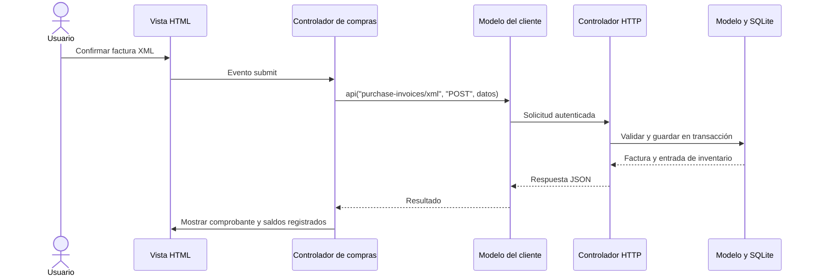

# Arquitectura MVC de SIPRO

La aplicación conserva Node.js, SQLite y JavaScript nativo. La separación MVC está presente tanto en la API como en la interfaz: los modelos manejan datos y reglas, las vistas presentan información y los controladores coordinan las acciones. Los archivos no son simplemente tres copias del antiguo `app.js`.

## Servidor

| Capa | Archivos | Responsabilidad |
| --- | --- | --- |
| Entrada | `server.js` | Puerto, variables de entorno, inicio y cierre. Exporta `createApp` para las pruebas. |
| Controlador | `src/controllers/http-controller.js` | Recibir HTTP, validar sesión/origen, dirigir cada operación al modelo y devolver respuestas. Sirve únicamente archivos del directorio público. |
| Modelo | `src/models/domain.js` | Permisos, validaciones de negocio, pedidos, ventas, compras, inventario y reportes. |
| Modelo | `src/models/store.js` | Persistencia y transacciones SQLite, contraseñas y datos iniciales. |
| Modelo | `src/models/purchase-xml.js` | Leer y validar el documento, asociar productos y registrar la compra. |
| Vista | `src/views/spreadsheet.js` | Convertir el resultado del reporte en SpreadsheetML para Excel. |

El modelo no importa controladores ni vistas. Las operaciones que modifican inventario siguen dentro de la transacción de `store.change()`. Una compra directa y sus movimientos se guardan juntos; una factura ligada a un pedido recibido conserva sus existencias. El navegador no decide permisos ni importes fiscales definitivos.

## Navegador

| Capa | Directorio | Responsabilidad |
| --- | --- | --- |
| Modelo | `public/js/models/` | Estado de sesión y borradores, comunicación JSON con la API, preferencias del ticket y totales provisionales. No accede al DOM ni importa vistas. |
| Controlador | `public/js/controllers/` | Leer formularios, atender eventos, llamar al modelo y actualizar la vista. Hay controladores de catálogo, inventario, pedidos, compras, ventas, reportes y usuarios. |
| Vista HTML | `public/views/` | Estructura de las pantallas, formularios, filas, diálogos y comprobantes. |
| Presentación JS | `public/js/views/` | Formato de moneda/fechas, composición de componentes, navegación, diálogo, notificaciones e impresión. |
| Presentación CSS | `public/styles/index.css`, `glass.css` | Distribución y reglas de impresión; tema oscuro aplicado exclusivamente a pantalla. |

`public/index.html` contiene el documento inicial, el contenedor de la aplicación, el diálogo y el área de impresión. `public/js/app.js` carga las plantillas y arranca el controlador principal mediante módulos ES. No hay JavaScript ni CSS en línea en las plantillas.

## Plantillas

Cada archivo contiene fragmentos identificados, por ejemplo `login-1` o `purchase-invoices-page-1`. `view(nombre, datos)` sustituye marcadores `{{{nombre}}}` sin ejecutar código. Los marcadores reciben texto escapado por `esc()` o fragmentos HTML creados por otras vistas. No se debe pasar texto libre del usuario directamente a un marcador: usa `esc(valor)` para contenido o atributos. Monedas y fechas pasan por sus formateadores.

El motor no interpreta expresiones JavaScript ni vuelve a procesar marcadores que aparezcan dentro de un valor. Una plantilla o dato requerido ausente produce un error explícito. Las pruebas cargan todas las plantillas reales, incluidas las de una sola línea, y comprueban el escape de datos en campos y tablas. Las tablas se componen con filas y celdas completas.

## Guía para modificar

- **Cambiar estructura o texto de una pantalla:** editar su archivo en `public/views/`.
- **Cambiar colores, transparencia, sombras o transiciones:** editar `public/styles/glass.css`. Está limitado a `screen`; no modifica el papel del ticket.
- **Cambiar un evento o el proceso de un formulario:** editar el controlador correspondiente en `public/js/controllers/`.
- **Cambiar las reglas de inventario, impuestos o permisos:** editar el modelo del servidor en `src/models/`. Los cálculos del cliente solo ayudan a presentar el borrador.
- **Añadir una colección de vistas:** incluirla en `loadTemplates()` de `public/js/app.js` y reiniciar el servidor para actualizar el listado de recursos públicos.

La base sigue en `data/sipro.sqlite` y conserva su esquema. Esta reorganización no reinicia registros ni necesita una migración. Las rutas API y la forma de iniciar con `npm start` siguen vigentes.

## Verificación

`npm test` ejecuta pruebas del negocio, XML, persistencia, plantillas y recursos públicos. `npm run test:browser` recorre formularios reales en Chromium, incluyendo compras manuales/XML, inventario, pagos, roles, móvil, Excel y tickets de 80/58 mm. Las pruebas crean bases temporales. Las fuentes y las plantillas se sirven desde el mismo origen y se mantiene la política CSP sin `unsafe-inline` ni `unsafe-eval`.
